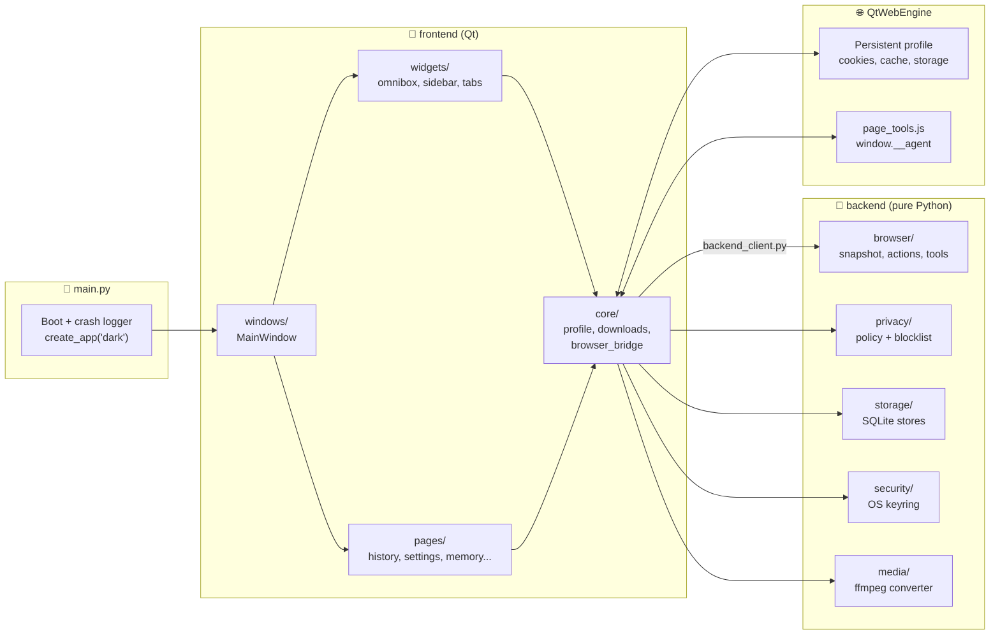
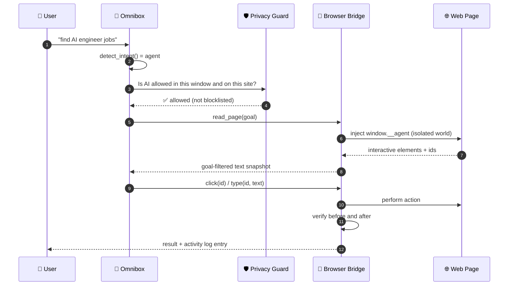
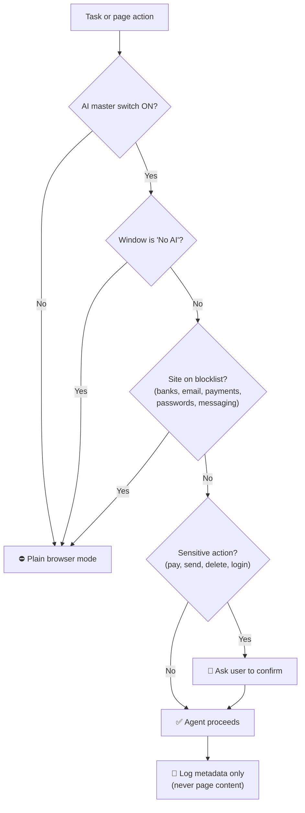
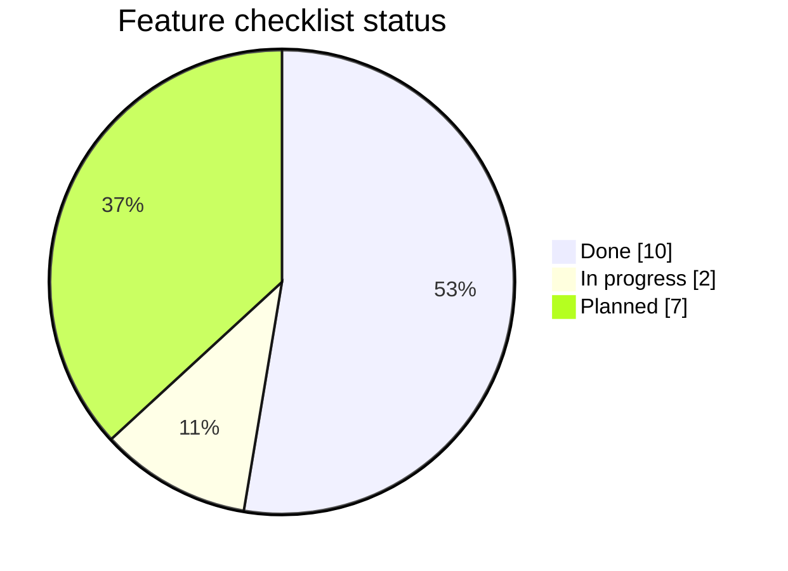
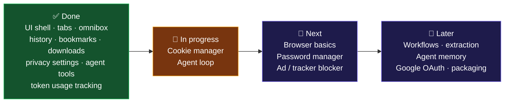

<!-- ===================== HEADER ===================== -->
<div align="center">


<br/>


<br/>

**Nexora** is an AI-native desktop browser built on PyQt6 + QtWebEngine, with an optional agent that lives inside the address bar, page-aware tools, and a privacy-first design.

<br/>

[**Features**](#-features) ·
[**Screenshots**](#-screenshots) ·
[**Architecture**](#-architecture) ·
[**Privacy**](#-privacy-first-ai) ·
[**Honest Limits**](#-honest-status--limitations) ·
[**Get Started**](#-getting-started) ·
[**Roadmap**](#-roadmap)

<br/>


</div>

---

## 🌌 What is Nexora?

**Nexora** is a desktop browser built on **PyQt6 + QtWebEngine**, with an AI agent that lives *inside the address bar*. Type a URL, a search, or a task, and Nexora works out which one you meant.

It is **not** a Chromium fork and **not** an Electron app. It is a lean, hackable, Python-first browser where an agent can read, click, type and scroll, but only if **you** allow it.

> 💡 **Core idea:** the browser should still feel like a browser. AI is a power tool, not a replacement for the web.

> 🚧 **Reality check:** Nexora is an early-stage, single-developer project. The browser core works day to day, the AI agent side is still being built. See [Honest Status & Limitations](#-honest-status--limitations) before you rely on it.

<table>
<tr>
<td width="33%" align="center">

### 🧭 Real Browser
Tabs, history, bookmarks, downloads, sessions, DevTools, permissions.

</td>
<td width="33%" align="center">

### 🤖 Agent-Ready
Semantic page snapshots with element ids, designed for LLM agents.

</td>
<td width="33%" align="center">

### 🔒 Privacy-Aware
Master AI switch, No-AI windows, site blocklist, metadata-only audit log.

</td>
</tr>
</table>

---

## ✨ Features

### 🖥️ Browser Core

| Feature | Details |
|---|---|
| 🗂️ **Multi-tab browsing** | Tab ids (`t1`, `t2`...), background tabs stay alive and muted |
| 🪟 **Multi-window** | Extra windows cascade, open Home, close with their last tab |
| 🧠 **Smart omnibox** | Detects `url`, `search` or `agent` intent. `!` = dev commands. `Alt+Enter` forces AI |
| 🔒 **Security indicators** | HTTPS lock / HTTP warning icon in the address bar |
| 📜 **History** | SQLite-backed, searchable, grouped by day |
| ⭐ **Bookmarks** | Star toggle synced live across windows |
| ⬇️ **Downloads** | Chrome-like popup, live downloads page, persistent history |
| 🧩 **Session restore** | Restore tabs on startup, `Ctrl+Shift+T` reopens a closed tab |
| 🛠️ **DevTools** | Inspect, view source, built-in dev console |
| 🔎 **Zoom + font size** | Per-page zoom, global font size setting |
| 🍪 **Persistent profile** | Cookies, localStorage and cache survive restarts |
| 🖱️ **Custom context menu** | Open in default browser, Inspect and more |

### 🎨 UI / UX

- 🌑 **Dark-only** theme built on design tokens (`theme.py` + `base.qss`)
- 📚 **Hover-expanding sidebar** (56px → 248px) with nebula art and labelled pages: Home, Browse, History, Agents, Tasks, Memory, Downloads, Bookmarks, Settings
- 🖼️ **Home page** with quick-access tiles and a default, custom image or video background (custom video is converted to VP9 `.webm` through ffmpeg)
- ⚙️ **Settings** for General, AI and privacy, Home background, Browsing, Downloads, Network and Privacy

### 🤖 AI & Agent Tooling

| Tool / Feature | What it does | Status |
|---|---|---|
| `read_page` | Goal-aware semantic snapshot (interactive elements with ids) | ✅ Working |
| `click` / `type` / `scroll` / `navigate` | Page actions with before and after verification, never touches password fields | ✅ Working (self-tested) |
| `tabs` | List, open, switch, close tabs, including background tabs | ✅ Working |
| 📊 **Token usage page** | Today / this month / all-time counters, 14-day input vs output chart, optional own budget limit | ✅ Working |
| Planner / agent loop | Multi-step tasks from the omnibox | 🔄 In progress |
| Workflows, extraction, agent memory | Structured extraction and reusable workflows | 📅 Planned |

---

## 📸 Screenshots

| Home | History | Memory (token usage) |
|:---:|:---:|:---:|
|  |  |  |

---

## 🏗️ Architecture

Hard rule: **`frontend/` holds all Qt UI. `backend/` is pure Python with zero Qt imports.** The frontend reaches the backend through one bridge.



### 🔁 How the agent sees a page



### 📂 Project Structure

```text
browser/
├── main.py                    # boot only: crash logger + create_app()
├── requirements.txt
├── backend/                   # pure Python, no Qt
│   ├── browser/               # snapshot.py, actions.py, tools.py
│   ├── privacy/               # policy.py (default blocklist)
│   ├── security/              # secrets.py (OS keyring)
│   ├── storage/               # history / bookmarks / downloads stores
│   └── media/                 # video_converter.py (ffmpeg → VP9 webm)
└── frontend/                  # all Qt UI
    ├── app.py                 # QApplication + theme + MainWindow
    ├── windows/               # main_window.py (orchestrator)
    ├── widgets/               # address_bar, sidebar, tab_bar, web_view...
    ├── pages/                 # history, bookmarks, downloads, settings, memory...
    ├── core/                  # profile, settings_manager, downloads, bridge
    ├── assets/                # icons, home.html, backgrounds, sidebar art
    └── styles/                # theme.py + base.qss
```

---

## 🔐 Privacy-First AI

Nexora is designed around one question: *"What if I don't want an AI watching my browsing?"*



| 🛡️ Design rule | How it is handled |
|---|---|
| **AI fully optional** | Master switch, plus per-window "New window (no AI)" (`Ctrl+Shift+N`) |
| **Blocklist** | Accounts, email, banks, payments, password managers, messaging, login and checkout paths, plus your own list |
| **Passwords untouched** | The agent never reads or types into password fields |
| **Secrets stay safe** | API keys live in the OS keyring, never in settings, logs or the frontend |
| **Untrusted web text** | Page text is treated as data, never as instructions |
| **Activity log** | Metadata only, viewable in settings |
| **User-only auth** | Google login, CAPTCHA and passwords are always done by you |

> ⚠️ Nexora never bypasses authentication, CAPTCHA, anti-bot checks or access controls, and does not fake browser identity to get past a site's security check.

---

## ⚠️ Honest Status & Limitations

This project is built openly and **imperfectly**. Here is what you should know before using or judging it.

### 🧪 Project maturity

| Reality | Detail |
|---|---|
| **Early stage** | One developer, in active development. Expect bugs and rough edges |
| **Tested on Ubuntu only** | Windows and macOS have not been tested |
| **Mostly manual testing** | There is a built-in `!selftest` for agent tools, but no full automated test suite |
| **Run from source** | No installer or packaged release yet |
| **Not security-audited** | Do not rely on it for banking or other high-risk browsing. Use a mainstream browser for that |
| **UI language** | Some interface text is currently written in Roman Urdu / Hinglish and is not localised yet |

### 🤖 AI limitations

| Limitation | Detail |
|---|---|
| **Agent loop is unfinished** | Page tools work and are self-tested, but full multi-step planning is still in progress. Do not expect a polished autonomous agent |
| **Agents make mistakes** | LLMs can pick the wrong element or misread a page. Actions are verified, but not guaranteed correct. Sensitive actions require confirmation |
| **Remote models see page text** | With a remote provider, your task and the filtered text snapshot of the page are sent to that provider. Blocklisted sites are skipped, but the blocklist is a safeguard, not a guarantee. For full isolation use a No-AI window or turn AI off |
| **Token counts are local estimates** | The Memory page counts only calls made from this browser. It cannot read your real provider balance or billing |
| **Provider limits apply** | Rate limits of your provider (for example tokens per minute) still apply. Your own budget setting pauses new agent work when reached |
| **Text snapshots only** | The agent reads text and element ids. No screenshots or vision yet, so visually complex pages can be hard for it |

### 🌐 Browser engine limitations

| Limitation | Why | Workaround |
|---|---|---|
| No H.264 / AAC playback | The pip build of QtWebEngine lacks proprietary codecs | Right-click → **Open in default browser** (VP9 / Opus works) |
| No DRM or passkeys | Not available in QtWebEngine | Use your system browser |
| Google sign-in blocked | Google blocks embedded browsers | System-browser OAuth is planned |
| More CAPTCHAs than Firefox | Chromium-only client hints, and identity is kept honest on purpose | Solve them yourself. Nexora will not bypass them |
| No extensions | QtWebEngine does not support them | Built-in ad/tracker blocker and userscripts are planned |
| Engine updates follow PyQt | Chromium security fixes arrive with `PyQt6-WebEngine` updates, not instantly | Keep dependencies updated |

### 🚫 Not built yet

- Cookie manager (in progress, still has a loading bug)
- Find in page (`Ctrl+F`), fullscreen, tab reorder and pin
- Print / PDF, certificate-error page, private window
- Password manager (planned through the OS keyring, never visible to the agent)
- Ad / tracker blocker and userscripts
- Workflow engine, structured extraction, agent long-term memory
- Google OAuth sign-in, packaging, sync, mobile

---

## 📊 Project Status at a Glance

Counts below come straight from the checklist in the [Roadmap](#-roadmap), not from guessed percentages.



---

## 🚀 Getting Started

### Requirements

- Python **3.10+** recommended
- Developed and tested on **Ubuntu**. Other systems are untested
- `ffmpeg` (optional, only for converting custom video backgrounds)

### Install

```bash
# 1. Clone
git clone https://github.com/life2-byte/NEXORA.git
cd NEXORA

# 2. Virtual environment
python -m venv venv
source venv/bin/activate        # Windows: venv\Scripts\activate

# 3. Dependencies
pip install -r requirements.txt

# 4. Run
python main.py
```

**AI setup (optional):** open **Settings → AI and privacy**, pick your provider and add the API key. Keys are stored in your OS keyring, not in files. Skip this to use Nexora as a normal browser.

### 🗃️ Where your data lives

```text
~/.config/agentic-browser/
├── settings.json        # preferences
├── history.db           # browsing history
├── bookmarks.db         # bookmarks
├── downloads.db         # download history
├── profile/             # cookies + localStorage
├── cache/               # disk cache
├── backgrounds/         # your custom home media
├── ai_activity.log      # AI audit log (metadata only)
└── crash.log            # crash + faulthandler output
```

---

## ⌨️ Keyboard Shortcuts

| Shortcut | Action | Shortcut | Action |
|---|---|---|---|
| `Ctrl+T` | New tab | `Ctrl+W` | Close tab |
| `Ctrl+N` | New window | `Ctrl+Shift+N` | New **No-AI** window |
| `Ctrl+Shift+T` | Reopen closed tab | `Ctrl+L` | Focus address bar |
| `Ctrl+H` | History | `Ctrl+J` | Downloads |
| `Ctrl+D` | Bookmark page | `Alt+Enter` | Ask AI from omnibox |
| `Ctrl+=` / `Ctrl+-` / `Ctrl+0` | Zoom in / out / reset | `F12` / `Ctrl+Shift+I` | DevTools |
| `Ctrl+U` | View source | `Ctrl+Shift+O` | Open in default browser |

---

## 🧪 Dev Console

Type `!` in the omnibox to drive the browser directly. Useful for testing agent tools one at a time.

```text
!read          !page          !find <text>      !click <id>
!type <id> ..  !typego <id>   !scroll <dir>     !go <url>
!tabs          !newtab        !switch <id>      !closetab <id>
!identity      !selftest                         @t2  ← target a tab
```

---

## 🗺️ Roadmap



<details>
<summary>📋 <b>Detailed checklist</b></summary>
<br/>

**✅ Done (10)**
- [x] UI shell, tabs, omnibox with intent detection, hover sidebar
- [x] Home page with image / video backgrounds
- [x] Settings persistence, right-click menu, DevTools, view source
- [x] New tab / window, No-AI window, multi-window
- [x] History, bookmarks, persistent profile
- [x] Downloads (popup + page), cache limit
- [x] Session restore, reopen closed tab
- [x] AI privacy settings (master switch, blocklist, activity log)
- [x] Agent tools self-test (read / click / type / scroll / go / tabs)
- [x] Token usage tracking with own budget limit

**🔄 In progress (2)**
- [ ] Cookie manager (per-site list, accept/block policy, delete on exit)
- [ ] Agent loop with step limit, safety guard and confirmations

**📅 Planned (7)**
- [ ] Find in page, fullscreen, tab reorder / pin
- [ ] Print / PDF, certificate-error page, private window
- [ ] Password manager (OS keyring)
- [ ] Ad / tracker blocker and userscripts
- [ ] Multi-tab workers, structured extraction, workflow engine
- [ ] Agent long-term memory
- [ ] Google OAuth (system browser + token) and packaging

</details>

---

## 🤝 Contributing

Ideas, bug reports and PRs are welcome. Please keep to the architecture rules:

1. `backend/` must never import Qt.
2. The frontend reaches the backend only through `frontend/api/backend_client.py`.
3. No secrets in code, logs or settings. Use the OS keyring.
4. Anything touching auth, CAPTCHA or passwords stays **user-driven**.

---

## 👨‍💻 Author

<div align="center">

**Ahmed Umair** · CS student @ UET Lahore · Founder, **PixelMindTech**

[](https://github.com/life2-byte)
[](https://www.linkedin.com/)

<br/>

⭐ **If Nexora looks interesting, a star helps a lot.** ⭐


<sub>Nexora · early-stage · built by Ahmed Umair</sub>

</div>
